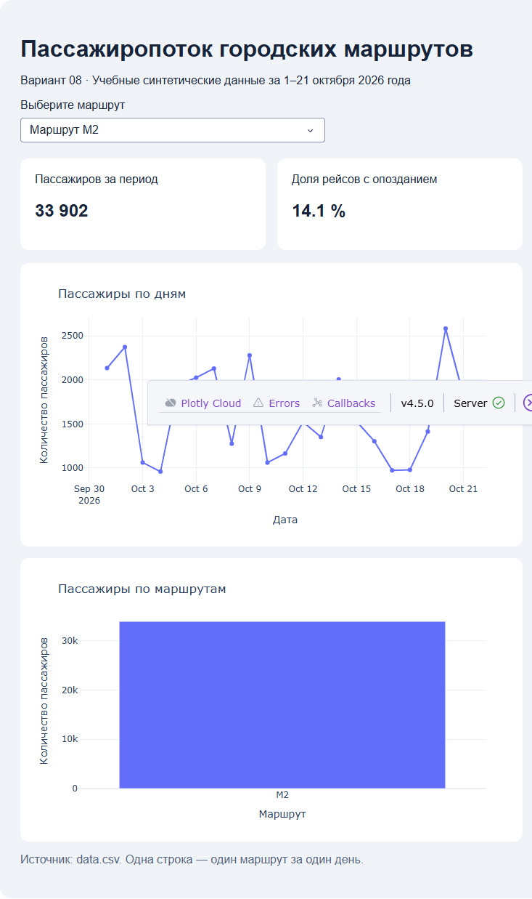

# Анализ пассажиропотока городских маршрутов

**Студент:** Гридин Харитон Геннадьевич  
**Группа:** ШАДк-111  
**Вариант:** 08  
**Исходный файл:** `variant_08.csv`, скопирован в корень проекта как `data.csv`.

## Результаты анализа

1. Самый загруженный маршрут за весь период: **M3 — 63,996 пассажиров**.
2. Максимальный суммарный пассажиропоток за день: **01.10.2026 — 8,680 пассажиров**.

За весь период три маршрута перевезли **137,550 пассажиров**. Доля рейсов с опозданием составила **12.8 %**.

## Запуск

Требуется Python 3.12. В терминале из этой папки выполните:

```bash
python -m venv .venv
```

Windows PowerShell:
```powershell
.\.venv\Scripts\Activate.ps1
```

macOS / Linux:
```bash
source .venv/bin/activate
```

Установите зависимости и запустите приложение:

```bash
python -m pip install -r requirements.txt
python app.py
```

Откройте http://127.0.0.1:8050 в браузере. Выберите «Все маршруты», M1, M2 или M3 — показатели и графики обновляются автоматически.

## Скриншот

После запуска приложения выберите маршрут **M2** и сохраните скриншот страницы в файл `screenshot.png` в этой папке. Затем добавьте строку:

```markdown

```

## Состав проекта

- `app.py` — приложение Dash с выполненными TODO 1–7;
- `data.csv` — данные варианта 08;
- `requirements.txt` — необходимые библиотеки;
- `.gitignore` — исключения для Git.
